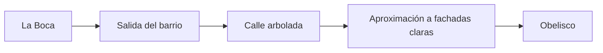

# Cómo se repiten las zonas y cómo diseñar transiciones

[Inicio de arte](README.md) · [Medidas y prefabs](Prefabs.md) · [Crear mapas](NewMaps.md)

## La calle es una cadena de piezas

El ciclista permanece cerca de la cámara y el escenario avanza hacia atrás. El juego coloca módulos de 12 metros uno detrás de otro. Cuando quedan atrás, los reutiliza para preparar el camino que viene.

El sistema mantiene una ventana de 14 módulos, incluidos dos detrás del avance. Por eso no se modela toda la ciudad ni se coloca un único edificio gigante como fondo del tramo.

En la ficha de una zona, **Modules** es una lista ordenada. Si contiene A, B y C, la repetición es:

```text
12 m      12 m      12 m      12 m      12 m      12 m
  A   →     B   →     C   →     A   →     B   →     C   → ...
```

No es una elección aleatoria. Una lista `A, A, B, C` repite ese orden. **Modules** define las variantes disponibles y su secuencia; **Module Count** en el recorrido define cuántas piezas dura el tramo. Con tres variantes y un tramo de 30 módulos, se recorren diez vueltas de A/B/C.

Cada sección nueva empieza desde el inicio de la lista de su zona. La última sección del recorrido continúa repitiéndose hasta que termina la partida.

## Cómo hacer que la repetición se note menos

- Conservar la geometría de unión y variar fachadas, alturas, cartelería y vegetación dentro del módulo.
- Distribuir los elementos llamativos entre varias piezas. Un edificio muy singular en cada repetición se reconoce enseguida.
- Evitar que el borde de todos los módulos tenga el mismo árbol o poste. Mirar juntas varias piezas antes de dar una variante por terminada.
- Revisar también la unión del último módulo con el primero: en una zona repetida, ese borde aparece durante la partida.
- Usar elementos de escala cotidiana para que el tamaño de edificios y veredas se lea bien desde la bicicleta.

Un landmark, como el Obelisco, es un recurso separado de los módulos. Así no se repite como si fuera otro edificio de cada cuadra.

## Una transición es un tramo diseñado

Una transición no cambia de escena ni reinicia la partida. Es otra sección del recorrido, con sus propios módulos, que conecta visualmente dos zonas.



En este ejemplo, los tres bloques del medio forman la transición. El recorrido actual tiene 360 m de La Boca, 192 m de transición y después Obelisco continuo.

## Preparar una transición paso a paso

1. **Elegir qué se conserva.** Mantener la calzada y los carriles. Elegir elementos que puedan aparecer en ambos barrios: árboles, iluminación o mobiliario.
2. **Diseñar la salida.** Las primeras piezas todavía deben reconocerse como parte de la zona de origen. Reducir gradualmente su rasgo más característico.
3. **Diseñar un tramo de enlace.** Una plaza, calle arbolada o fachadas más neutras permiten cambiar densidad, paleta y alturas sin un corte brusco.
4. **Anticipar el destino.** Introducir materiales, siluetas o vegetación de la siguiente zona antes de entrar por completo. La vista a distancia también importa.
5. **Crear las variantes.** Duplicar módulos y preparar sus visuales siguiendo [el contrato de montaje](Prefabs.md). Revisar todas las uniones.
6. **Ordenar la lista.** En el perfil de transición, asignar **Modules** en el orden del recorrido deseado. Repetir referencias permite prolongar una fase sin duplicar su archivo.
7. **Dar una duración al tramo.** En el recorrido, colocar esa zona entre origen y destino, indicar **Module Count** y activar **Transition**. No poner cero en una sección intermedia.
8. **Revisar el ambiente.** Ajustar cielo y niebla del perfil de transición para que el inicio se parezca al origen. El sistema mezclará esos valores hacia los de la sección siguiente.

Para una secuencia de transición que no deba volver a empezar, usar una lista que cubra toda su duración. Si la lista tiene solo tres variantes y **Module Count** es 16, repetirá A/B/C y terminará en A; no las estirará ni pasará una sola vez por cada fase.

Una disposición posible de 16 posiciones es dos de salida, ocho de enlace y seis de aproximación. El tiempo se estima como `módulos × 12 / velocidad`. A 18–28 m/s, 16 módulos representan aproximadamente 7–11 segundos sin contar ralentizaciones. Elegir la duración mirando el recorrido en movimiento.

## Qué hace el campo Transition

Al activarlo, el juego mezcla el color del fondo y los valores de niebla del perfil actual hacia los de la sección siguiente. También genera encuentros más suaves y conserva un paso legible.

**No transforma edificios ni mezcla automáticamente texturas de suelo.** El cambio de arquitectura se construye con los módulos. El suelo se asigna por zona; si sus materiales son muy diferentes, se verá la unión. Mantener un suelo común durante el enlace o preparar fases adicionales con perfiles de superficie intermedios.

## Cómo revisar la transición

Primero mirar las uniones en una escena de revisión: origen/primera pieza, cada pareja intermedia y última pieza/destino. Después pedir una revisión del recorrido completo desde la cámara del juego, incluyendo la aproximación antes de entrar a la transición.

El recorrido contiene un tramo inicial de 360 m: la vista previa del inicio no alcanza para juzgar la transición. Verificarla desde la partida o coordinar con desarrollo una configuración de recorrido corta para revisión; no cambiar el orden de producción solamente para verla antes.

| Si se observa… | Revisar |
|---|---|
| Salto brusco de color al entrar | Ambiente inicial de la transición y materiales del borde |
| La salida del barrio reaparece a mitad del enlace | Lista Modules demasiado corta para el Module Count |
| Pavimento cortado de golpe | Materiales entre perfiles; Transition no hace fundido de texturas |
| Troncos, autos o ramas en el paso | Geometría de Art invadiendo la calzada |
| Edificios pegados o huecos | Piezas de 12 m, pivotes y unión entre vecinos |

Para registrar los perfiles y preparar una zona nueva, continuar con [Nuevos mapas y recorridos](NewMaps.md).
